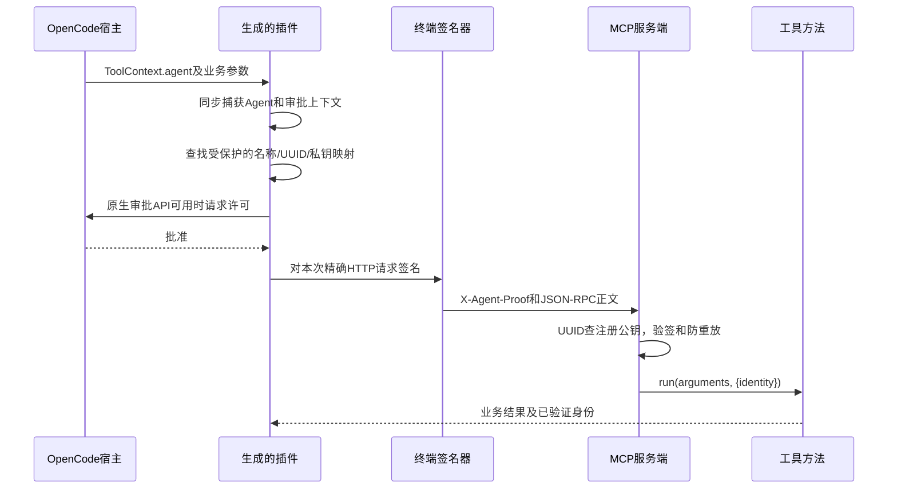

# 独立 MCP Agent 身份验证包 1.1.0

可在本机验证的完整工程，不需要 AKB、Octop、数据库、Docker、Service Key 或在线登记服务。需要 **Node.js 22+**；Windows 密钥保护需要 **Windows PowerShell 5.1+ 和支持 ACL 的 NTFS 卷**。

服务端为每个 UUID 登记公钥，每个 HTTP 请求都验证对应私钥签名，再把不可变身份交给 MCP 工具方法。OpenCode 插件从真实执行上下文读取 Agent 名称，模型只填写业务参数。

这是独立的本地演示协议 `mcp-agent-proof+jwt`，不是直接兼容 AKB V2 的客户端。OpenCode **1.x 与 2.x 使用独立入口**：1.x 兼容 Promise/Effect 审批，2.x 使用原生 `setup`、`tool.transform`、`permission.assert`。生成器默认同时输出两份配置。早期宿主没有审批 API 时，必须显式启用只读兼容模式；完整范围见 [COMPATIBILITY.md](COMPATIBILITY.md)。

## 下载包包含什么

- `lib/server.mjs`：本地 HTTP MCP 服务端；三个工具的方法都能获取 `context.identity`。
- `lib/proof.mjs`：UUID、公钥指纹、RS256 请求证明与验签。
- `lib/client.mjs`：终端签名请求、MCP 初始化/工具调用、身份确认。
- `lib/opencode-plugin.mjs`：OpenCode 1.x 插件实现（函数入口、字符串结果）。
- `lib/opencode-plugin-v2.mjs`：OpenCode 2.x 原生插件实现（setup、JSON Schema、结构化结果）。
- `lib/opencode-compat.mjs`：版本识别、身份快照和取消处理。
- `lib/generator.mjs`：UUID/公私钥生成、公钥登记、插件生成、一键配置生成。
- `lib/protection.mjs` / `files.mjs`：Windows SID ACL 与 POSIX 权限保护。
- `bin/lab.mjs`：统一 CLI。
- `RUN-DEMO.ps1`：Windows 一键生成、启动服务和双 Agent 验证。
- `test/lab.test.mjs`：真实 HTTP 和插件自动化测试。
- `examples/terminal-config.example.json`：手工配置形状示例。

**v1.1-ready.zip** 附带运行依赖，解压后直接执行 `node` 命令，不附带 Node 运行时；**v1.1-source.zip** 是轻量源码，先执行 `npm ci` 安装固定依赖。服务端/密钥生成/终端验证本身只使用 Node 内置模块，只有 OpenCode 插件和测试需要 npm 依赖。

## Windows 最快验证

将 v1.1-ready.zip 解压到固定目录，例如 `C:\tools\mcp-agent-identity-lab`。准备一个真实项目目录 `C:\work\demo-project`。在 PowerShell 中执行：

```powershell
Set-Location C:\tools\mcp-agent-identity-lab
node --version
.\RUN-DEMO.ps1 -Workspace C:\work\demo-project -OpenCodeMajor 2
```

上例生成 2.x 插件；1.x 用 `-OpenCodeMajor 1`，同时生成两版用 `-OpenCodeMajor both`（默认）。

脚本会在当前用户目录下创建全新的 `mcp-identity-data-<时间>`，自动生成 `build` 和 `plan` 两个 Agent 的 UUID、独立 RSA-3072 密钥、公钥注册表与插件。随后打开服务端窗口，分别调用 MCP `whoami` 验证两个身份。

如本机执行策略阻止脚本，可按组织允许的执行策略运行，或使用下述手动 `node` 命令；程序不会修改系统执行策略。

成功输出包含：

```json
{
  "verified": true,
  "identity": {
    "uuid": "每个Agent不同的实际UUID",
    "agentName": "build",
    "kid": "公钥指纹",
    "sessionId": "terminal",
    "invocationId": "实际调用UUID",
    "verified": true
  }
}
```

两个 Agent 的 UUID/kid 应不同。`verified` 来自服务端工具返回的已验签上下文；终端还会核对 UUID 和名称是否与本地配置一致。

## 手动运行：两个 PowerShell 窗口

窗口一，生成一次配置并启动服务：

```powershell
Set-Location C:\tools\mcp-agent-identity-lab
# 新目录，不能已经存在；放在 Agent 项目工作区之外。
$dataDir = "$env:USERPROFILE\mcp-identity-demo"
node bin/lab.mjs demo --out $dataDir --workspace C:\work\demo-project --agents build,plan --port 8765 --opencode-major both
node bin/lab.mjs server --registry "$dataDir\registry.json" --port 8765
```

窗口二，先验证服务端，再调用具体工具：

```powershell
Set-Location C:\tools\mcp-agent-identity-lab
$dataDir = "$env:USERPROFILE\mcp-identity-demo"
node bin/lab.mjs verify --config "$dataDir\terminal-config.json" --agent build
node bin/lab.mjs verify --config "$dataDir\terminal-config.json" --agent plan
# 用文件传 JSON，避免 Windows PowerShell 原生命令的引号转义差异。
@{ a = 12; b = 30 } | ConvertTo-Json | Set-Content "$dataDir\add-args.json" -Encoding ascii
node bin/lab.mjs call --config "$dataDir\terminal-config.json" --agent build --tool add --args-file "$dataDir\add-args.json"
```

`add` 返回 `sum: 42`，同时返回调用方的已验证 UUID/名称。可用工具：

| MCP 工具 | 业务参数 | 返回 |
| --- | --- | --- |
| `whoami` | `{}` | 当前已验证身份 |
| `echo_secure` | `{"text":"hello"}` | 原文及已验证身份 |
| `add` | `{"a":12,"b":30}` | 和及已验证身份 |

默认监听 `127.0.0.1:8765`。`GET /health` 无需认证，仅返回健康状态；`POST /mcp` 的 initialize、tools/list、tools/call 等请求均需要签名。本实现提供 MCP 2025-06-18 的无状态 JSON HTTP 交换；不提供 SSE、订阅或持久会话。

Linux/macOS 同样可以运行上述 Node 命令，将路径换成绝对路径即可。

## 在真实 OpenCode 使用插件

先运行版本检测：

```powershell
node bin/lab.mjs doctor --workspace C:\work\demo-project
# 若 PATH 中只有 .cmd 包装器，指定其底层真正 exe：
node bin/lab.mjs doctor --opencode C:\tools\opencode.exe --workspace C:\work\demo-project
```

`doctor` 识别 1.x/2.x，并输出对应的 `opencode.v1.fragment.json` 或 `opencode.v2.fragment.json` 名称。不支持的主版本会返回非零退出码。

| 宿主 | 应合并的文件 | 入口与配置格式 |
| --- | --- | --- |
| OpenCode 1.x | `plugin/opencode.v1.fragment.json` | 函数入口 `identity-plugin.mjs`；`plugin` + `permission` |
| OpenCode 2.x | `plugin/opencode.v2.fragment.json` | `opencode-v2` 插件目录；`plugins` + `permissions` |

**只合并匹配主版本的一份配置**，保留已有插件及权限。不要把 1.x 的文件入口填入 2.x；2.x 需要目录入口及 `setup(ctx)`。生成的 2.x 目录包含 `package.json` 与 `exports`，可按官方本地插件目录方式加载。

合并到 OpenCode 全局配置后重启，从批准的项目目录运行：

```powershell
Set-Location C:\work\demo-project
opencode run --agent build '调用 identity_whoami，告诉我服务端验证到的 UUID 和 Agent 标识'
opencode run --agent plan '调用 identity_whoami，告诉我服务端验证到的 UUID 和 Agent 标识'
```

插件暴露 `identity_whoami`、`identity_echo`、`identity_add`，向 MCP 服务端调用 `whoami`、`echo_secure`、`add`。名称来自宿主执行上下文：1.x 为实际 Agent 配置名，2.x 为实际 Agent ID，不能用 UI 显示名称或模型参数代替。

有审批 API 时，拒绝或取消审批不会发出 MCP 请求。某些早期 1.x（如 1.0.142/1.1.4）和早期 2.x（如 2.0.28）没有对应审批方法；默认拒绝执行。只为本包三个本机只读演示工具使用时，可显式开启：

```powershell
.\RUN-DEMO.ps1 -Workspace C:\work\demo-project -OpenCodeMajor both -LegacyReadOnly
# 或 CLI：在 demo 命令加 --legacy-readonly true
```

这会在受保护配置中写入 `legacyReadOnly: true`。此模式仍严格校验真实 Agent、工作区、UUID、公钥签名和防重放，但旧宿主上不会由插件弹出审批。已有配置可由操作者手工添加该布尔项后重启。新宿主即使设置此项也仍使用其原生审批，不会跳过。

`plan` 受本机权限策略限制时，换一个允许工具调用的真实 Agent，并配置对应身份。不要改用模型填写的 Agent 名称。未知或缺失的身份上下文始终拒绝执行。

解压目录和生成目录应保持位置不变；插件使用绝对文件 URI。移动后用新包重新生成插件，不必重新生成 UUID/密钥。

## 单独生成身份、登记公钥、生成插件

```powershell
# 独立生成；--uuid 可省略，省略时生成随机 UUID。
node bin/lab.mjs keygen --out "$env:USERPROFILE\new-agent" --agent myagent
# enrollment.json 仅含 UUID、名称、公钥、kid；不含私钥。
node bin/lab.mjs register --registry "$dataDir\registry.json" --public "$env:USERPROFILE\new-agent\enrollment.json"
```

把新 Agent 的名称、UUID、`private.pem` 路径加入受保护的 `terminal-config.json`，完整形状参考 examples。然后为该配置生成一个新的插件目录：

```powershell
node bin/lab.mjs plugin --config "$dataDir\terminal-config.json" --out "$dataDir\plugin-new" --opencode-major both
```

所有路径参数使用绝对路径。输出目录必须不存在，不会覆盖已有密钥。添加公钥只通过本地管理命令完成，HTTP 服务没有开放注册接口。

在 `registry.json` 将某 Agent 的 `enabled` 改为 `false` 后，下一次请求即拒绝该身份，无需重启；同一 UUID 换用不同名称或公钥时登记命令会拒绝，演示包不自动覆盖公钥。

## 身份如何到达工具方法



`lib/server.mjs` 中的工具方法示例：

```javascript
run(args, context) {
  const identity = verifiedIdentity(context);
  // identity.uuid / identity.agentName / identity.kid
  // 此身份来自服务端验签，与模型传入的 args 无关。
  return { identity };
}
```

增加新工具时沿用这一调用方式。模型在参数里添加 UUID、Agent 名称或 `verified: true`，不会成为有效身份；服务端会拒绝不在 schema 范围内的参数，插件也只传递各工具允许的业务字段。

## 签名协议与本地验证边界

- RSA-3072 / RS256；私钥留在终端，只在服务端登记公钥。
- 证明 Header 为 `X-Agent-Proof`，JWS 类型为 `mcp-agent-proof+jwt`。
- 签名覆盖 UUID、Agent 名称、目标 URL、HTTP 方法/路径、精确正文 SHA-256、会话/调用 ID、签发/过期时间与随机 jti。
- 服务端按 UUID 找到公钥，并同时核对名称和 kid；客户端不能提交任意公钥来通过认证。
- 每份证明有效期最多 30 秒，未来时间容差 5 秒，每个请求使用新 jti。initialize 和 tools/call 分别签名。
- 防重放缓存位于内存；重启服务后缓存清空。需要生产部署时应换成持久、共享的原子消费存储。
- 服务端每次请求重新读取注册表，避免撤销后继续使用旧授权缓存。
- 私钥和配置必须位于工作区外；Windows 按 SID 设置/回读 ACL，POSIX 使用 0700/0600。
- 同账户任意程序或恶意插件若能访问私钥，仍可冒用身份；需要强隔离时使用独立账户/签名器。
- 本包仅监听本机 HTTP，用于客户端持钥身份验证；不提供服务端 TLS 身份证明、生产级授权系统或跨机器部署。

## 测试与排错

```powershell
npm test
# 源码包安装开发依赖后，可额外校验 V2 官方 SDK 接口：
# npm run check:contracts
```

测试覆盖真实 HTTP MCP 双 Agent、工具身份上下文、无签名拒绝、跨 Agent 密钥拒绝、正文/名称篡改、过期/未来证明拒绝、重放拒绝、即时撤销、OpenCode 审批拒绝/取消、模型参数伪造、生成器不覆盖以及 CLI 验证。

| 现象 | 检查 |
| --- | --- |
| `HTTP 401` | UUID/名称是否登记、kid/私钥是否匹配、enabled、系统时间、是否重放 |
| `HTTP 403` | 使用默认 `http://127.0.0.1:<port>/mcp`，不要改写 Host 或添加其他 Origin |
| `HTTP 503` | 注册表是否有效、服务账户是否有安全读取权限 |
| `owner-only` / ACL 错误 | 数据目录在工作区外；NTFS；当前账户拥有目录；Windows PowerShell 可用 |
| `EEXIST` | 使用新的输出目录，不要删除已有私钥后强行重建同一身份 |
| OpenCode Agent 未登记 | ToolContext.agent 必须与配置及登记名称一致；更新后重启宿主 |
| 插件导入失败 | ready 包需完整保留 node_modules；source 包先 npm ci；检查对应主版本入口及 COMPATIBILITY.md |
| 8765 端口占用 | 换端口重新生成 demo；或同步修改配置与服务端端口 |

自动化测试在 Linux/Node 24 上执行，覆盖 V1 Promise/Effect 和 V2 的原生 API 形状，并对 V2 模块通过官方 2.2.5 SDK 类型检查。没有声称已在真实 Windows NTFS 或真实 OpenCode/模型宿主上验收；请在你的目标机器执行上面的步骤。
