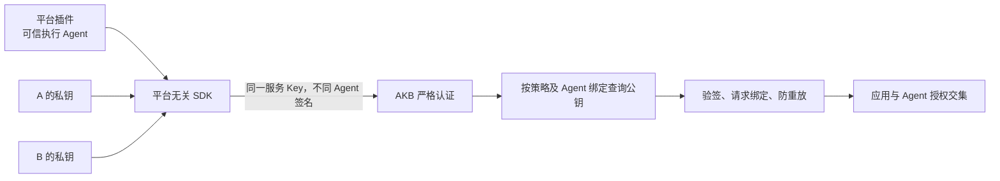
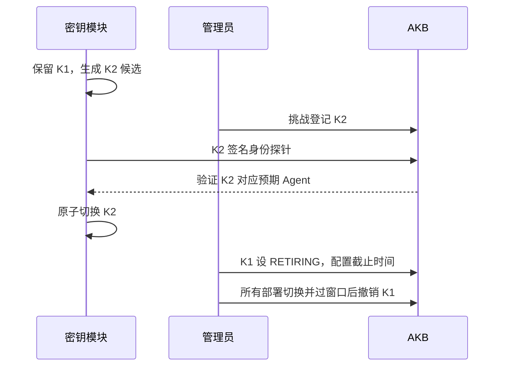

# 跨平台 Agent Identity SDK：AKB 配套改造设计

状态：设计已落实于 V75 与 SDK/插件 0.2.0；本文为架构决策背景。实际接口、状态机和限制以 [V2 接入文档](../api/AGENT-IDENTITY-V2.md) 为准。现有 V1 认证保留，SDK 暂以本地 TGZ 交付。

## 1. 目标与认证变化

保留一个安装下多个 Agent 共用一个严格服务 Key；将身份签名从“安装私钥”升级为“Agent 独立私钥”。通用 SDK 负责密钥生成、存储、签名与请求绑定；平台插件只提供可信执行上下文及审批。

AKB 直接登记 Agent 公钥，插件不再需要托管外部 JWKS。信任根由“安装 JWKS 可以声明任何批准 Agent”收窄为“指定公钥只能证明其所属 Agent”。



Agent 稳定 ID 使用持久化 UUID，不能把 kid 当 Agent ID。每 Agent 每安装默认独立密钥，轮换不改主体 ID。仅有相同静态 Key 而平台没有可信运行上下文时，SDK 无法解决身份区分。

规范来源：Octop 仓库 `integrations/agent-identity-spec/` 的 README、PLUGIN-DEVELOPMENT、KEY-MANAGEMENT、PROTOCOL-V2 和 contracts.ts。包名为设计名，未发布。

## 2. Profile 与兼容性

策略新增：

```text
proof_profile = INSTALLATION_RS256_V1 | AGENT_KEY_RS256_V2
platform_id = opencode / 其他受控平台标识
resource_origin = AKB 公开 HTTPS origin
```

旧策略默认 V1。V1 保留 issuer/JWKS 行为。V2 使用登记公钥，jwks_uri 为空；需在新迁移中允许该列为空，并由管理服务按 profile 校验字段，禁止填假 URL 应付原 NOT NULL。

Key 仍使用 APPLICATION_WORKLOAD 和 workload_policy_id。已认证 Key 决定使用哪个 profile，不能让 JWT 自行选择 V1/V2。V2 不接受安装断言或 LEGACY 降级，客户端不自动回退。

不同平台/安装默认独立策略和共享 Key，可归同一 APPLICATION；同一策略可容纳多个 Agent。不要为了跨平台复用而让一个 Key 隐式适配多个策略。

## 3. 数据模型建议

使用新的 Flyway 迁移，编号以实施时最新版本为准，不修改已经应用的 V74。

### t_workload_agent_key

| 字段 | 规则 |
|---|---|
| id | 主键，登记记录 ID |
| policy_id / binding_id | 必须指向同一策略下的现存 Agent 绑定 |
| kid / jkt | 公钥 RFC7638 SHA-256 指纹，首版两者相同 |
| alg | 仅 RS256 |
| public_jwk | 受限 RSA 公钥 JSON，禁止任何私钥参数 |
| status | ACTIVE、RETIRING、REVOKED |
| valid_from / valid_until | 接收窗口；RETIRING 必须有截止时间 |
| created_by / created_time | 管理员及登记时间 |
| revoked_by / revoked_time / reason | 撤销信息 |

约束：`UNIQUE(policy_id,kid)`，同策略同公钥不得属于不同 Agent；校验 binding.policy_id 与 policy_id 一致。跨策略/安装也建议独立生成密钥，首版的唯一约束不宣称全局禁止公钥复用。

最多允许每绑定少量并行有效版本，例如 2 个 ACTIVE/RETIRING，避免无限登记。REVOKED 为终态，重新启用需新密钥和新登记，不能把状态直接改回 ACTIVE。

### t_workload_key_challenge

保存 challenge_id、policy_id、binding_id、public_jwk、jkt、nonce_hash、expires_at（用途固定为登记）、created_by、consumed_at。随机 nonce 至少 32 字节；5 分钟到期；按管理员/策略限流并限制未完成数量。

服务端保存候选公钥，不从完成请求的 JWS 中接受另一把公钥。一次完成应在同一事务中消费挑战、插入公钥记录、写管理审计；失败不得留下半激活记录。

### t_workload_v2_jti

唯一键建议 `(policy_id,kid,jti)`，保存 expires_at；使用共享数据库或等效原子存储。消费应在业务执行前独立持久化，不能随业务异常回滚后允许重放。清理增加合理时间余量，不依赖每台 JVM 独立缓存。

### 审计

现有调用审计增加 proof_profile、signing_kid、agent_key_registration_id、workload_message_id、platform_id。保留 applicationPrincipalId、agentPrincipalId、sessionId、invocationId；未验签身份不写为已验证主体。

## 4. 管理接口草案

以下接口已实现；请结合 V2 接入文档部署。管理接口继续只允许 AKB 系统 ADMIN 登录，不接受外部服务 Key。

公共前缀 `/api/external/admin/workload`：

| 方法与路径 | 行为 |
|---|---|
| POST /policies | 增加 proofProfile/platformId/resourceOrigin；V1/V2 按模式校验 |
| POST /policies/{p}/agents | 复用已批准稳定 Agent ID 与 runtimeAgentKey 的登记 |
| POST /policies/{p}/agents/{b}/keys/challenges | 提交候选 publicJwk，创建持钥挑战 |
| POST /policies/{p}/agents/{b}/keys/registrations | 提交 challengeId + registrationProof，验持钥并激活公钥 |
| GET /policies/{p}/agents/{b}/keys | 查看公钥元信息和状态，绝不返回私钥 |
| PUT /policies/{p}/agents/{b}/keys/{kid}/status | 退休或撤销，强制状态机 |
| POST /policies/{p}/keys | 复用现有严格共享服务 Key 签发；profile 从策略取得 |

V2 策略创建示例：

```json
{
  "applicationPrincipalId": 123,
  "proofProfile": "AGENT_KEY_RS256_V2",
  "issuer": "https://identity.example.com/opencode",
  "audience": "akb-external-api",
  "platformId": "opencode",
  "installationId": "opencode-office-01",
  "workspaceId": "engineering-01",
  "resourceOrigin": "https://akb.example.com"
}
```

V2 issuer 是策略命名空间，不要求存在 issuer 网站；V2 不从该 URL 取密钥。resourceOrigin 由受控部署配置核对，不能由客户端任意指定。反向代理 public origin 配置必须明确，不能直接信任外部 Host/Forwarded。

创建挑战请求：

```json
{
  "publicJwk": {
    "kty": "RSA", "n": "<modulus>", "e": "AQAB",
    "kid": "<RFC7638 thumbprint>", "alg": "RS256", "use": "sig"
  }
}
```

响应应包括 challengeId、nonce、policyId、bindingId、externalAgentId、jkt、purpose、audience、expiresAt。所有响应都不含私钥。插件端只签与本地 Owner 相符的挑战；管理员传递公钥包及挑战即可，不需把管理 Token 配到插件。

完成登记请求：

```json
{
  "challengeId": "<一次性挑战ID>",
  "registrationProof": "<专用登记JWS>"
}
```

证明类型为 akb-key-registration+jwt，aud 为 akb-agent-key-registration；登记用途与请求用途严格隔离。核对创建挑战的管理员、策略、绑定、公钥指纹、nonce、时间及 purpose。有效持钥证明不自动产生 KB 授权。

## 5. 身份状态探针

已新增 `GET /api/v1/external/identity/status`：使用候选 Agent 私钥签发的完整 V2 请求证明和共享 Key，执行同一认证链，不需要先把候选 kid 选为本地默认版本。

要求 LIST scope，只返回当前已认证的 agentId、applicationPrincipalId、policyId、kid、proofProfile、keyStatus，不返回其他 Agent 列表或授权资料。此路由不要求 KB grant，因为它不读取知识库内容。

运维工具核对返回身份符合预期后，原子更新本地活动 kid。探针只能验证服务端接受该身份，不能代替独立知识库授权验证。

## 6. 验证实现拆分

建议将现有 `WorkloadIdentityService` 保留为严格模式调度入口：

```text
ExternalAccessService
  → Key 认证和策略加载
  → WorkloadIdentityService
      → InstallationProofVerifierV1
      → AgentKeyProofVerifierV2
  → 不可变 VerifiedWorkloadIdentity
  → 限流、scope、KB/标签授权和审计
```

V1/V2 共享精确正文缓存、常量时间摘要比较、公用只读授权和安全错误映射；密钥发现和 claim 校验分开。不要让 V2 接触远程 JWKS，也不要在 V2 错误后尝试 V1。

V2 验证顺序：

1. Header/body 限制及网关预限流；共享 Key/应用/策略 ACTIVE。
2. 检查策略 profile，解析有界 JWS。未验签 sub/runtime_agent/kid 仅作安全参数化查找提示。
3. 查询当前策略下绑定及其公钥，拒绝跨 Agent 的 kid；检查算法、有效期和密钥状态。
4. RS256 验签，强制 typ/ver，核对 issuer/audience/resource/policy/azp/platform/安装/工作区及绑定。
5. 校验 exp、iat、TTL、Service Key 摘要及方法/path/query/body 摘要。
6. 原子消费 jti，建立已验证不可变身份；执行额度与资源授权。
7. 审计明确记录 V2 和 kid，不记录凭据或完整证明。

验证器必须限制算法，检查 RSA 3072–4096 位及指数 65537；拒绝 JWK 私钥参数、外来公钥 URL、重复 JSON 字段与错误类型。密钥/绑定状态每请求查询或使用有严格失效保证的共享缓存；撤销默认下一次认证生效。

错误语义遵循 PROTOCOL-V2。为避免枚举，未知 kid/绑定统一认证失败；只有可信验证后的停用状态才区分授权拒绝。身份存储不可用时 503，不能回退放行。

## 7. 授权和额度

保持只读 scopes：SEARCH、QUERY、LIST、READ_OBJECT。V2 不直接开放 Memory、写入、个人用户委托。知识库范围仍为 APPLICATION grants ∩ 已验证 AGENT grants；资料标签沿用明确的三态语义。

Service Key 继续归 APPLICATION，不能把 ApiKey.principalId 改成每次 Agent。已验证 Agent 保存在不可变请求身份内，避免并发串号。

建议补分布式应用/Agent/Key 多层限流；最少在验签前做网关速率和 Header/body 限制，避免所有无效证明都消耗数据库与 RSA 资源。一次 MCP 工具执行通常产生多个 HTTP 请求，配额按明确定义计量。

## 8. 轮换、停用和回滚



紧急泄漏不等待退休窗口，直接撤销 kid 或暂停绑定；宿主失陷则暂停策略/撤销共享 Key 并轮换所有可能泄漏的密钥。REVOKED 不允许重新 ACTIVE。

V2 出现问题时暂停 V2 策略并修复，不把同一 Key 降为 LEGACY。若业务必须暂时回到 V1，需管理员显式创建/启用独立旧策略凭据并接受其较宽信任边界，不进行静默自动回退。

## 9. 实施清单与验证

| 阶段 | 改造点 | 验证 |
|---|---|---|
| SDK 提取 | core/keystore/runtime/client，平台依赖只留适配器 | 原 V1 行为及现有 195 后端/5 插件测试基线不回退 |
| 数据与管理 | 新迁移、profile、公钥/挑战/状态机、管理审计 | 管理权限、并发登记、公钥所有权、挑战到期及重放 |
| V2 验证 | 固定公钥、claim、Key/resource/request 绑定、nonce | 跨 Agent kid、算法混淆、正文/path/query/Key/resource 篡改均拒绝 |
| 生命周期 | 探针、双钥窗口、不可逆撤销 | K2 切换、K1 退出、单 Agent 停用不影响另一 Agent |
| 真实宿主 | OpenCode 1.14.30 迁移、至少另一平台独立适配 | 相同共享 Key、不同公钥和 Agent 审计，自有私有库有结果、交叉访问拒绝 |
| 生产边界 | shell/文件工具隔离、分布式限流、日志脱敏 | 验证 Agent 执行环境不可读取其他身份密钥和管理配置 |

上述原测试数量是已有实现的历史基线，不是本次设计新增实现的测试结果。本次已实现 SDK、V2 管理及验证，并运行实际联调；验证数量以交付记录为准。

## 10. 未解决的安全问题

每 Agent 独立密钥仍不隔离同进程或同 UID 恶意代码；签名句柄、KMS 和模块化本身不证明调用者是谁。需要强隔离时，可信宿主建立绑定执行身份的通道，工具执行沙箱拿不到其他 Agent 的凭据或通道能力。

Agent 切换、父子任务委托及实际用户授权是独立课题。V2 仅保证“此请求的密钥属于此登记 Agent”，不自动计算“父 Agent 权限 ∩ 子 Agent 权限”，也不证明提示词/模型配置完整性。
