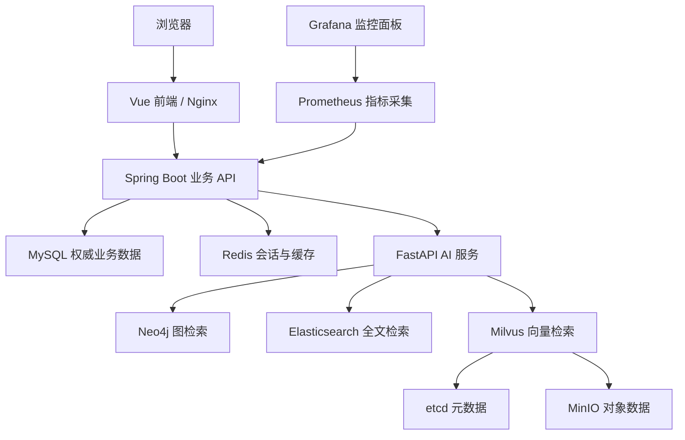

# AKB 服务器部署镜像与代码映射技术说明

> 依据 AKB 当前仓库代码、Docker Compose、Dockerfile、部署脚本与仓库文档编写。本文同时对照服务器提供的容器清单。  
> 服务器容器清单：`kos-dev-*`；应用镜像使用 `remote` 标签，数据/中间件镜像使用 `knowledge-os/*:1.1.0` 或版本标签。

## 1. 阅读结论与范围

服务器目前运行的是 12 个容器，覆盖 Web 前端、Java 业务 API、Python AI 能力、关系型数据库、缓存、图/全文/向量检索设施，以及监控采集和展示。

仓库能直接确认每个服务的技术栈、构建方式、启动入口、数据目录、端口及依赖；也能从 `docs/operations/COMMANDS.md` 确认 6 个 `*-data:1.1.0` 镜像是基于上游中间件、把已准备好的数据卷内容重新打包的**数据镜像**。

但服务器上的完整 Compose 文件、镜像 digest、构建 commit 和启动参数并未随这份容器清单提供。尤其 `ai-knowledge-os-frontend:remote` 等名字不等于仓库 `docker-compose.dev.yml` 中声明的镜像名。因此：

- 本文按容器职责将镜像映射到仓库代码，并明确代码证据。
- `remote` 标签是否对应当前某个 Git commit、服务器 Compose 是否有额外参数，需在服务器检查镜像 digest、OCI labels 和 Compose labels 后才能最终确认。
- 下面给出的状态检查与 Compose 行为，若标明“仓库编排”，表示以仓库中的开发编排为准；服务器实际健康检查以 `docker inspect` 的结果为准。

## 2. 系统架构总览



核心边界：

- **MySQL 是业务知识状态的权威存储**：知识库、来源、文档、ContentUnit、Evidence、Card、Claim、裁决、权限、任务及索引发布记录等以关系数据为准。
- **AI Service 负责 AI 与检索处理**：解析、切分、抽取、Embedding、查询理解、召回融合、重排、上下文组装和答案生成。
- **Elasticsearch、Milvus、Neo4j 是检索/图能力的物理服务**：保存全文、向量和图结构的检索视图。平台支持从业务状态重建索引；不要把任一单独索引副本当作完整业务备份。
- **Prometheus + Grafana 是观测平面**，不参与知识业务请求的必要路径。
- **模型服务是外部依赖**：Ollama 或 OpenAI 兼容 API 由 `LLM_BASE_URL` 等配置指向，不在本清单的容器中。

## 3. 镜像、容器和代码对应关系

### 3.1 用户提供的运行清单

| 状态 | 容器 | 镜像 | 镜像类别 | 对应代码/配置 |
|---|---|---|---|---|
| running | `kos-dev-grafana` | `knowledge-os/grafana:12.1.1` | 官方 Grafana 版本的仓库/私有 Registry 命名 | `monitoring/grafana/provisioning/`、`monitoring/grafana/dashboards/` |
| running | `kos-dev-prometheus` | `knowledge-os/prometheus:v3.5.0` | 官方 Prometheus 版本的仓库/私有 Registry 命名 | `monitoring/prometheus.yml`、`monitoring/alerts.yml` |
| running | `kos-dev-frontend` | `ai-knowledge-os-frontend:remote` | 应用镜像 | `frontend/`、`frontend/Dockerfile`、`frontend/nginx.conf` |
| healthy | `kos-dev-milvus` | `knowledge-os/milvus-data:1.1.0` | Milvus 基础镜像 + 已装载的向量数据目录 | `ai-service/app/services/indexer.py`、`ai-service/app/services/retrieval/`、`ai-service/app/storage/index_store.py`；数据目录 `/var/lib/milvus` |
| healthy | `kos-dev-backend` | `ai-knowledge-os-backend:remote` | 应用镜像 | `backend/`、`backend/Dockerfile`、`backend/entrypoint.sh` |
| healthy | `kos-dev-ai` | `ai-knowledge-os-ai-service:remote` | 应用镜像 | `ai-service/`、`ai-service/Dockerfile` |
| healthy | `kos-dev-es` | `knowledge-os/es-data:1.1.0` | Elasticsearch 基础镜像 + 已装载的索引和安全配置 | `ai-service/app/services/retrieval/`、索引器相关服务；数据目录 `/usr/share/elasticsearch/data` |
| healthy | `kos-dev-minio` | `knowledge-os/milvus-minio-data:1.1.0` | MinIO 基础镜像 + Milvus 对象数据 | Milvus 的对象存储依赖；数据目录 `/minio_data` |
| healthy | `kos-dev-neo4j` | `knowledge-os/neo4j-data:1.1.0` | Neo4j 基础镜像 + 图数据 | `ai-service/app/storage/graph_store.py`、`ai-service/app/services/graph_provider.py`；数据目录 `/data` |
| healthy | `kos-dev-mysql` | `knowledge-os/mysql-data:1.1.0` | MySQL 基础镜像 + 预置知识库业务数据 | `backend/src/main/resources/db/migration/`、`backend/src/main/resources/mapper/`、`backend/src/main/java/com/jh/knowledgeos/`；数据目录 `/var/lib/mysql` |
| healthy | `kos-dev-etcd` | `knowledge-os/milvus-etcd-data:1.1.0` | etcd 基础镜像 + Milvus 元数据 | Milvus 元数据依赖；数据目录 `/etcd` |
| healthy | `kos-dev-redis` | `redis:7-alpine` | 官方 Redis 基础镜像 | Backend 的 Spring Data Redis 配置；开发编排数据目录 `/data` |

### 3.2 三种镜像命名不能混为一谈

| 服务器 tag 示例 | 本质 | 仓库对应方式 |
|---|---|---|
| `ai-knowledge-os-frontend:remote` / `...-backend:remote` / `...-ai-service:remote` | 含 AKB 应用代码的运行镜像 | 仓库 Dockerfile 分别编译前端、Java 后端、Python 服务。`remote` 是 tag，不是源码目录或 Git 分支名。 |
| `knowledge-os/mysql-data:1.1.0` 等 6 个数据镜像 | 以上游中间件为基础，将已运行实例的数据目录复制进镜像层 | 仓库在 `docs/operations/COMMANDS.md` 第八节记录了数据卷停机、tar 导出、带属主解包、再以 `*-data:1.1.0` 构建并推送的流程。 |
| `knowledge-os/grafana:12.1.1` / `knowledge-os/prometheus:v3.5.0` | 按企业 Registry 命名空间管理的监控软件版本 | 仓库 Compose 直接引用上游 `grafana/grafana:12.1.1`、`prom/prometheus:v3.5.0`，并挂载仓库监控配置。服务器的 `knowledge-os/*` 多半是镜像别名/复制后的命名，实际来源仍应检查 RepoDigest。 |
| `redis:7-alpine` | 上游基础服务镜像，没有在用户列表中显示自定义 data tag | 仓库 `docker-compose.dev.yml` 使用该版本并挂载持久卷。 |

**重要：**当前仓库的开发 Compose 对应用服务写的是 `build: ./frontend`、`build: ./backend`、`build.context: ./ai-service`，并未给这三个服务声明 `ai-knowledge-os-*:remote` 这样的 `image:` 名称。仓库正式发布脚本则使用 `knowledge-os/{frontend,backend,ai-service}:<VERSION>`。因此服务器上的 `remote` 镜像来源与 tag 规则属于部署侧差异，应通过 labels/digest 或对应服务器 Compose 文件核验，不能仅凭名称断言它们对应哪个 commit。

## 4. 逐镜像技术栈与核心代码

### 4.1 前端：`ai-knowledge-os-frontend:remote`

**技术栈**：Vue 3、TypeScript、Vite、Element Plus、Axios；容器构建阶段使用 Node 20 Alpine，运行阶段使用 Nginx 1.27 Alpine。

**构建与运行链路**：

1. `frontend/Dockerfile` 在 Node 阶段安装 npm 依赖并执行 `npm run build`。
2. Vite 输出静态文件到 `dist/`。
3. Docker 多阶段构建只把 `dist/` 复制到 Nginx 镜像；生产容器不运行 Node 开发服务器。
4. `frontend/nginx.conf` 提供 SPA history fallback（不存在的静态路径回退到 `index.html`），并把 `/api/` 代理到 Compose 网络中的 `backend:8080`。
5. API 代理超时为 600 秒，上传体积上限设置为 2048 MB，用于支持批量资料导入等长请求。

**核心代码入口**：

- 页面外壳与一级模块：`frontend/src/App.vue`
- 知识生成、检索、工作台：`frontend/src/components/GeneratePage.vue`、`SearchPage.vue`、`WorkbenchPage.vue`
- 请求定义：`frontend/src/api/`
- 路由与壳层能力：`frontend/src/navigation.ts`、`frontend/src/shell.ts`
- Nginx 路由：`frontend/nginx.conf`

**注意**：浏览器访问前端容器名不等于 API 地址；浏览器走宿主机端口访问 Nginx，Nginx 再通过 Docker DNS 将 `/api` 送到 Backend。`depends_on` 在仓库 Compose 中按 Backend healthy 控制启动顺序，但它不会替代运行期间的重试/容错。

### 4.2 Java 业务后端：`ai-knowledge-os-backend:remote`

**技术栈**：Java 8、Spring Boot 2.7.18、Spring MVC、MyBatis 2.3.2、MySQL Connector/J、Flyway、Spring Security OAuth/Jose、Spring Data Redis、Actuator、Micrometer Prometheus、Springdoc OpenAPI。Maven 3.9.9 + Eclipse Temurin 8 用于构建；最终镜像为 Eclipse Temurin 8 JRE，并安装 curl、MySQL 客户端。

**启动链路**：

- `backend/Dockerfile` 先缓存 Maven 依赖、编译生成 Spring Boot JAR，再将 JAR 和默认策略配置放入轻量 JRE 层。
- `backend/entrypoint.sh` 根据 `DEMO_SEED` 判断是否尝试灌入演示快照，之后执行 `java -jar /app/app.jar`。
- Web 默认监听 8080；仓库开发编排的健康检查请求 `/actuator/health`。
- Flyway 默认开启启动迁移，迁移文件位于 `backend/src/main/resources/db/migration/`；校验和启用，已应用迁移不要回改。

**职责与主要代码区**：

- `controller/`：HTTP API、知识治理、导入、检索入口、管理与 MCP/API 接口。
- `service/`：业务用例、授权、知识生命周期、Outbox、索引发布等。
- `domain/`：业务实体与值对象。
- `mapper/` + `src/main/resources/mapper/*.xml`：MyBatis 持久化查询。
- `src/main/resources/db/migration/`：数据库演进。
- `application.yml`：数据库、Redis、AI Service 地址、Actuator、上传上限等运行配置。

**重要数据边界**：MySQL 是业务状态主库；索引和图服务用于检索视图。索引生成/传播涉及 Transactional Outbox 与独立索引工作器能力。服务器这 12 个容器列表中没有单独的 `index-worker`，因此需要确认当前部署是否关闭 Outbox worker、是否由 Backend 承担，或工作器在另一个 Compose 项目中运行；否则积压事件可能没有消费者。

### 4.3 Python AI 服务：`ai-knowledge-os-ai-service:remote`

**技术栈**：Python 3.10 slim、FastAPI 0.115、Uvicorn 0.30、Pydantic 2、NumPy、Neo4j Python driver；文档解析包含 PyMuPDF、pypdf、python-docx、BeautifulSoup。可选 ML 依赖由 Docker build arg `INSTALL_ML=true` 安装，主要用于 reranker 等模型，不应未经评估就在小内存服务器启用。

**入口**：`ai-service/Dockerfile` 复制 `app/` 和默认 `config/`，通过 Uvicorn 启动 `app.main:app`，监听 12000。`/health` 是轻量存活检查，`/ready` 能显示模型、Embedding、图、检索引擎配置概况；容器 healthy 并不等价于外部 LLM、ES、Milvus 的端到端检索都成功。

**核心代码**：

- `ai-service/app/main.py`：FastAPI 生命周期、路由注册、Trace ID 与统一异常响应。
- `app/routes.py`：主要问答、文档处理等 API。
- `app/services/document_parser.py`：PDF/DOCX/文本等输入解析。
- `app/services/extractor.py`、`adjudication_engine.py`、`conflict_detector.py`：知识抽取、质量与冲突治理协作。
- `app/services/query_engine.py`、`query_understanding.py`、`retrieval/`：查询理解、多通道召回与融合。
- `app/services/embedding.py`、`reranker.py`、`llm_provider.py`：模型 Provider 抽象、向量化、重排、生成。
- `app/services/indexer.py`、`app/storage/index_store.py`、`graph_store.py`：索引与图/向量存储适配。
- `/app/data`：运行时配置、索引/上传等持久状态；`KNOWLEDGE_DATA_DIR` 默认由 Compose 指向该目录。

**模型依赖**：Ollama/OpenAI 兼容模型通过 `LLM_PROVIDER`、`LLM_BASE_URL`、`LLM_MODEL` 配置；Embedding 有独立 Provider 与维度。改 Embedding 模型或维度后，需要重新构建索引，不能只重启 AI 容器。

### 4.4 MySQL：`knowledge-os/mysql-data:1.1.0`

**基础技术**：MySQL 8.0.36，`utf8mb4` / `utf8mb4_0900_ai_ci`，时区 +08:00。仓库开发 Compose 设置最大连接数 500、最大包 256 MB、开发环境 InnoDB buffer pool 512 MB；目标机实际参数以其 Compose 为准。

**数据与代码对应**：

- 数据目录 `/var/lib/mysql` 是 MySQL 物理数据目录；`mysql-data:1.1.0` 把开发环境已灌入的数据库文件随镜像交付。
- Schema/增量结构由 Flyway 文件维护，不应通过手动修改线上 schema 取代迁移。
- MyBatis mapper 维护读写查询；Java `domain/service/controller` 实现业务行为。
- 演示种子数据也可能由 Backend 镜像内 `/opt/demo-seed` 按 `DEMO_SEED` 加载；数据镜像和演示恢复是两条不同的数据初始化途径，不要不清楚两者优先级时同时强制重放。

**核心提醒**：数据库镜像包含的初始化账户、密码、已有数据状态由打包时的卷决定。MySQL 官方镜像的 `MYSQL_DATABASE` / `MYSQL_USER` 等初始化变量只对空数据目录有效；已有数据目录时，修改环境变量通常不会重建账户或改密码。

### 4.5 Redis：`redis:7-alpine`

Redis 7 Alpine 作为缓存/会话类运行依赖，开发 Compose 使用 AOF 持久化、512 MB 上限与 `allkeys-lru`，密码可通过 `REDIS_PASSWORD` 配置，数据目录 `/data`。健康检查是 `PING`。

代码侧通过 `backend/src/main/resources/application.yml` 中的 `spring.data.redis`（依赖的 Spring Boot 自动配置）读取 host/port/password。服务器 Redis 健康只证明 Redis 接受 PING，不证明 Java 服务中的会话/缓存配置正确。

### 4.6 Neo4j：`knowledge-os/neo4j-data:1.1.0`

**基础技术**：Neo4j 5.26，HTTP 管理端口 7474、Bolt 端口 7687；AI Service 用 `bolt://neo4j:7687` 访问。图数据目录 `/data`，日志目录通常 `/logs`。

**代码映射**：图读写封装位于 `ai-service/app/storage/graph_store.py`；图检索/提供者封装位于 `ai-service/app/services/graph_provider.py`。其节点、边与属性服务于知识关系、图扩展召回与解释链路。

**密码陷阱**：Neo4j 的 `NEO4J_AUTH` 只会在数据目录首次初始化时建初始用户。已有 `/data` 后改环境变量并不能保证密码被重置。开发 Compose 还特意把健康检查密码放在非 `NEO4J_` 前缀的 `KOS_NEO4J_PASSWORD`，避免 Neo4j 把健康检查辅助变量识别成未知数据库配置。

### 4.7 Elasticsearch：`knowledge-os/es-data:1.1.0`

**基础技术**：仓库 Compose 对应 Elasticsearch 9.5.3，单节点运行。容器内 HTTP 9200；数据目录 `/usr/share/elasticsearch/data`，Java 堆在开发 Compose 中为 1 GB。开发编排显式关闭 HTTP TLS，但保留 ES 9 安全机制并以凭据健康检查。

**代码映射**：AI Service retrieval 目录和索引器代码负责全文 BM25 查询与知识文档索引。数据镜像不仅关系到业务索引；安全系统索引（例如 `.security-*`）、`elasticsearch.keystore` 和安全自动配置状态也会影响登录及凭据。

**已知高风险**：仓库部署文档指出 ES 的数据必须通过命名卷运行；将 Lucene 文件仅放在容器 overlay 层可能触发 `AlreadyClosedException`。数据镜像要带齐数据和 Elasticsearch 配置。不要随意删除看似“多余”的索引 UUID。

### 4.8 Milvus：`knowledge-os/milvus-data:1.1.0`

**基础技术**：Milvus 3.0.1 standalone，gRPC 19530、健康端点 9091。数据目录 `/var/lib/milvus`。AI Service 使用 `MILVUS_URL` 和集合/别名配置执行向量写入与召回。

**代码映射**：`ai-service/app/services/embedding.py` 生成向量；`indexer.py` 写入知识向量；`services/retrieval/` 执行向量召回；`storage/index_store.py` 抽象本地/外部索引状态。

Milvus 并非独立运行：它需要 etcd 提供元数据，并需要 MinIO 保存对象数据。Milvus 目录、etcd 目录、MinIO 目录共同构成一次一致性快照。

### 4.9 etcd：`knowledge-os/milvus-etcd-data:1.1.0`

**基础技术**：仓库 Compose 对应 etcd 3.5.18；监听容器网络内 2379，数据目录 `/etcd`。配置了 revision 压缩、保留窗口、后端 quota 和快照数。

它保存 Milvus 集群元信息，不是知识业务库，也不能脱离同一时刻的 Milvus/MinIO 数据单独回滚。

### 4.10 MinIO：`knowledge-os/milvus-minio-data:1.1.0`

**基础技术**：仓库 Compose 对应 MinIO `RELEASE.2025-07-23T15-54-02Z`，容器内 S3 API 9000、控制台 9001，数据目录 `/minio_data`。Milvus 通过 Docker DNS 地址 `milvus-minio:9000` 使用它。

使用 `MINIO_ROOT_USER` / `MINIO_ROOT_PASSWORD`，不要沿用老版本的 `MINIO_ACCESS_KEY` / `MINIO_SECRET_KEY` 配置。真实账号密码请在服务器端受控查看，不要粘贴到文档或工单。

### 4.11 Prometheus：`knowledge-os/prometheus:v3.5.0`

**技术栈**：Prometheus 3.5.0，默认每 15 秒抓取和评估规则；数据保存在 Prometheus 数据卷。配置来自只读挂载的 `monitoring/prometheus.yml` 和 `monitoring/alerts.yml`。

- Backend 抓取目标：`backend:8080/actuator/prometheus`。
- 仓库监控配置还声明 `index-worker:8081/actuator/prometheus`。
- 仓库 `docker-compose.dev.yml` 没有定义 `index-worker` 服务，所以若服务器仍沿用此监控配置、且没有别的 Compose 项目或网络提供 `index-worker` DNS，Prometheus 会显示该 target 为 DOWN。这不一定导致 Prometheus 容器退出，但会造成工作器指标缺失。
- 数据目录 `/prometheus`，容器内服务端口 9090；开发 Compose 映射宿主机 9092。

### 4.12 Grafana：`knowledge-os/grafana:12.1.1`

Grafana 12.1.1 读取 `monitoring/grafana/provisioning/datasources/prometheus.yml` 自动配置 Prometheus 数据源，读取 `monitoring/grafana/provisioning/dashboards/llmkb.yml` 加载文件式仪表板，具体 Dashboard JSON 位于 `monitoring/grafana/dashboards/llmkb-slo.json`。

现有 SLO 面板包括后端 P95、5xx 比例、Outbox 延迟/重试/死信、索引投递耗时和 JVM heap。Grafana 容器内端口 3000；开发 Compose 映射宿主 3001。管理员账号密码由 `GRAFANA_ADMIN_USER` / `GRAFANA_ADMIN_PASSWORD` 注入。开发 Compose 没有为 Grafana 声明容器 healthcheck，因此 `running` 只是进程运行状态，应另外请求 `/api/health` 验证服务。

## 5. 健康状态怎么看

容器状态来自 Docker 的 healthcheck 定义或无 healthcheck 时的进程状态，两者含义不同：

| 显示状态 | 通常代表 | 不能据此推断 |
|---|---|---|
| `running` | 容器主进程没有退出 | HTTP 服务一定可用、下游依赖都正常 |
| `healthy` | 最近一次 Compose/Docker healthcheck 成功 | 完整业务链路（LLM、检索、授权、索引一致性）全部成功 |

根据仓库开发编排：MySQL 执行 `mysqladmin ping`；Redis 执行 `PING`；Neo4j 执行 `cypher-shell RETURN 1`；AI 执行 `/health`；Backend 执行 `/actuator/health`；ES 带凭据请求 cluster health；Milvus 请求 `/healthz`；etcd 执行 `endpoint health`；MinIO 请求 `/minio/health/live`。Prometheus、Grafana、前端在该 Compose 中没有定义 healthcheck。

## 6. 数据卷、数据镜像与一致性

### 6.1 数据镜像不是“程序镜像”

`*-data:1.1.0` 的主要作用是把一份已经建立的数据状态随镜像分发。它不会替代 MySQL/ES/Neo4j/Milvus 的服务端程序，也不会替代 Java/Python 的业务代码。底层仍应以兼容版本的上游中间件作为父镜像。

Docker 将镜像路径挂载到**新建的空命名卷**时，通常会把镜像路径中的初始文件复制到卷中；之后服务会修改卷内容。已有非空卷不会被新镜像内容自动覆盖。因此：

- 只 `pull` 更新 `mysql-data:1.1.0` 并重新创建容器，不代表现有数据库卷已经换成镜像里的数据。
- 验证镜像数据时必须确认容器实际挂载了哪个 volume，并确认 volume 是新建、空卷还是历史卷。
- 不要用 `docker compose down -v` 作为普通升级命令；它会删除持久化卷，可能造成不可恢复的数据丢失。

### 6.2 Milvus 三件套必须同批

Milvus、etcd、MinIO 的数据是在同一时间点、停止写入后一起导出的才可保证内部元数据和对象相互匹配。替换时也要同批替换。

### 6.3 MySQL 快照、Flyway 与代码版本

物理 MySQL 数据快照应和对应的 Backend/Flyway 迁移版本匹配。新 Backend 启动可能自动运行尚未应用的 Flyway migration。上线前应先备份、检查迁移文件与版本；如果数据镜像太旧而新代码要求新列/表，Backend 可能在启动迁移或业务 SQL 时失败。

### 6.4 Elasticsearch 安全状态

数据和 `/usr/share/elasticsearch/config` 的安全状态要保持一致。重跑安全自动配置可能改变 elastic 密码或造成 401。MySQL、Neo4j、ES 中已有用户/凭据不会因为更换容器环境变量自动重置。

## 7. 部署核验命令

以下命令以目标服务器执行。输出时不要公开 `.env`、容器完整环境变量或口令。

### 7.1 核实镜像、容器标签、摘要和挂载

```bash
# 核对容器实际使用的 image reference、image ID、Compose project/service labels
for c in kos-dev-grafana kos-dev-prometheus kos-dev-frontend kos-dev-milvus \
         kos-dev-backend kos-dev-ai kos-dev-es kos-dev-minio kos-dev-neo4j \
         kos-dev-mysql kos-dev-etcd kos-dev-redis; do
  docker inspect -f '{{.Name}} image={{.Config.Image}} id={{.Image}} project={{index .Config.Labels "com.docker.compose.project"}} service={{index .Config.Labels "com.docker.compose.service"}}' "$c"
done

# 查看镜像 digest、创建时间与构建来源 labels（如果构建时写入）
docker image inspect IMAGE_NAME \
  --format 'id={{.Id}} created={{.Created}} digests={{json .RepoDigests}} labels={{json .Config.Labels}}'

# 逐容器确认宿主目录/命名卷与容器内挂载点
for c in kos-dev-mysql kos-dev-redis kos-dev-neo4j kos-dev-ai kos-dev-es \
         kos-dev-etcd kos-dev-minio kos-dev-milvus kos-dev-prometheus kos-dev-grafana; do
  docker inspect -f '{{.Name}}{{range .Mounts}} {{.Type}}:{{.Name}}{{.Source}}->{{.Destination}}{{end}}' "$c"
done

# 查看容器实际 command/entrypoint 和端口，但不要打印 Config.Env（其中有密码）
docker inspect -f '{{.Name}} path={{.Path}} args={{json .Args}} ports={{json .NetworkSettings.Ports}}' kos-dev-backend
```

`labels` 中如果有 `org.opencontainers.image.revision`、`org.opencontainers.image.source`、`org.opencontainers.image.version`，可用来绑定代码仓库、Git commit 与版本；没有这些 labels 时，镜像内容无法仅靠 tag 证明来自某个 commit。`remote` 是可移动标签，建议部署改为不可变版本号或 digest pin。

### 7.2 容器与 HTTP 冒烟检查

```bash
docker ps --format 'table {{.Names}}\t{{.Image}}\t{{.Status}}'
docker logs --tail=200 kos-dev-backend
docker logs --tail=200 kos-dev-ai

curl -fsS http://127.0.0.1:8088/                 # 前端 HTML
curl -fsS http://127.0.0.1:8080/actuator/health # Backend
curl -fsS http://127.0.0.1:12000/health         # AI Service liveness
curl -fsS http://127.0.0.1:12000/ready          # AI 配置与检索提供者状态
curl -fsS http://127.0.0.1:9092/-/healthy       # Prometheus（若宿主映射为 9092）
curl -fsS http://127.0.0.1:3001/api/health     # Grafana（若宿主映射为 3001）
```

容器端口名按 Docker 网络内服务名解析；宿主机端口映射则以目标 Compose 文件为准。服务器若沿用 `docker-compose.dev.yml`，前端为 8088、Backend 为 8080、AI 为 12000、ES 为 9200、Milvus 为 19530、Neo4j 为 7474/7687、Grafana 为 3001、Prometheus 为 9092。

### 7.3 检查 Prometheus target

浏览器访问 Prometheus 的 `/targets` 页面，检查 `llmkb-backend` 与 `llmkb-index-worker`。若 `index-worker` 为 DOWN：

1. 确认服务器是否部署了独立 index-worker（在仓库发行 Compose 中它与 Backend 共用镜像，但端口为 8081）。
2. 确认 Prometheus 和 worker 在同一 Docker 网络中、DNS 名是 `index-worker`。
3. 若当前部署没有 worker，删除/注释对应 scrape target，或补充 worker 服务，避免仪表板误报缺指标。
4. 如果启用 Outbox，确认有且只有预期数量的消费者，观察重试和死信指标。

## 8. 代码改动与镜像开发指导

### 8.1 按代码路径决定要重建什么

| 改动内容 | 重建/更新目标 | 需要重启/检查 |
|---|---|---|
| `frontend/**` | 前端镜像 | Nginx 前端容器；检查静态资源、SPA 路由、`/api` 反向代理 |
| `backend/**` | Backend 镜像；若 Index Worker 独立部署也要更新同镜像 worker | Flyway migration、`/actuator/health`、业务接口、Outbox 消费状态 |
| `ai-service/**` / requirements | AI Service 镜像 | `/health`、`/ready`、模型/Embedding、ES/Milvus/Neo4j 的连通性 |
| `monitoring/**` | 不需重建 Prometheus/Grafana 镜像 | bind mount 配置；重启相应容器或按服务支持的 reload 流程加载 |
| `backend/src/main/resources/defaults/**` | 在开发 Compose 是 bind mount；正式交付可能进 Backend 镜像或配置卷 | 检查 `KNOWLEDGE_CONFIG_DIR` 与配置卷是否覆盖镜像内默认文件 |
| `db/migration/V*.sql` | Backend 镜像 + 目标 MySQL 自动迁移 | 先做 MySQL 备份；确认 Flyway 成功，禁止修改已应用 migration |
| 中间件配置/tag | 变更 Compose/环境变量；必要时拉取新中间件镜像 | 检查密码、数据目录兼容、健康检查、卷与回滚 |
| 要更新预置知识库数据 | 重新制作对应 `*-data` 镜像或使用受控数据导入 | MySQL 快照和 ES/Neo4j/Milvus 等索引的版本/一致性；Milvus 三件套同一快照 |

### 8.2 推荐研发流程

1. **定位职责边界**：业务规则与权限放 Backend；模型调用、解析和检索编排放 AI Service；页面交互放 Frontend；数据结构变化走 Flyway。
2. **本地验证**：Backend 执行 `mvn test`；前端执行 `npm ci && npm run lint && npm run typecheck && npm run build`；AI 执行 pytest 和项目 smoke scripts。镜像 Dockerfile 中后端跳过测试、前端只 build，因此测试要在制作镜像前完成。
3. **构建可追溯镜像**：使用版本号或 Git SHA tag；写入 OCI labels（source、revision、version、created）；记录 image ID 和 RepoDigest。避免把 `remote` 当长期唯一生产版本。
4. **仅更新改动服务**：代码镜像与数据镜像分开发布。不要为了发前端改动而重建数据库数据镜像。
5. **按依赖顺序上线**：先数据库迁移/基础中间件，再 AI Service，再 Backend/worker，最后前端；有变更时看健康状态和服务日志。
6. **做端到端验收**：上传一份小文档 → 查看解析结果 → 生成/审核知识 → 发起检索并确认引用 → 检查检索 trace 与对应 Grafana 指标。
7. **保留回滚条件**：保存旧镜像 digest、Compose 配置和 MySQL 备份；对有状态中间件先做可恢复备份，不能仅回退应用镜像就假设数据兼容。

### 8.3 当前仓库 Dockerfile 的改进建议

- 前端 Dockerfile 目前只先复制 `package.json` 并运行 `npm install`，建议同时复制 `package-lock.json` 并使用 `npm ci`，使构建更可复现。
- 建议三类应用镜像都在构建时写入 Git commit、版本、构建时间 OCI labels；运行环境增加 `/version` 或等价信息，减少 `remote` tag 无法追溯的问题。
- 后端当前 JRE 镜像安装 curl 和 MySQL client，是为健康检查和 demo seed 恢复脚本服务。若拆分职责，可把 demo seed 恢复作为初始化 Job，减少业务镜像中运维工具，但要保留兼容迁移方案。
- 应用镜像 tag 应使用不可变版本/commit tag，并把部署 digest 写入变更记录。Tag 可以被重新指向，digest 才能标识确切镜像内容。
- 生产服务应配置资源 requests/limits（Compose 可用 deploy/resource 约束或由 Swarm/Kubernetes 管理）、日志轮转、备份策略、只读配置、秘密注入与端口最小暴露。
- 服务器 Compose 与仓库版本应纳入版本控制或制品发布；否则仅检查 Git 仓库不能解释目标机上的实际端口、依赖、挂载与环境变量。

## 9. 重要注意事项清单

- [ ] `remote` 是可覆盖的 tag；部署时记录 commit label、image ID 和 RepoDigest。
- [ ] 先确认实际 Compose、服务名、Docker 网络、宿主端口映射，再按仓库默认值操作。
- [ ] 环境变量里有密码、token、LLM API key；不要用 `docker inspect .Config.Env` 把密钥打到日志或工单。
- [ ] 更换 MySQL/Neo4j/ES 数据镜像时，确认实际挂载卷；旧卷不会被新镜像数据自动覆盖。
- [ ] MySQL 数据快照要与 Flyway 版本兼容；先备份再升级。
- [ ] `NEO4J_AUTH` 与 MySQL 初始化密码变量不会自动覆盖非空数据目录里的账户。
- [ ] Elasticsearch 的 data 与 config/security keystore 必须一致；保留 `.security-*` 系统索引。
- [ ] Milvus、etcd、MinIO 的数据快照必须同一时刻生成和成组切换。
- [ ] `/health` 是存活检查，不代表模型与外部索引全部可用；还需检查 `/ready` 和端到端检索。
- [ ] 仓库 Prometheus 配置包含 `index-worker:8081` target，但仓库开发 Compose 未定义此服务；部署需明确 worker 是否存在。
- [ ] 停止容器与删除数据卷是不同操作；执行任何 `down -v`、volume prune 或数据镜像替换前先确认备份可恢复。

## 10. 仓库证据路径

- 开发 Compose 与健康检查：`docker-compose.dev.yml`
- 通用/交付 Compose：`docker-compose.yml`、`deploy/docker-compose.release.yml`、`deploy/docker-compose.prod.yml`
- 前端构建与反向代理：`frontend/Dockerfile`、`frontend/nginx.conf`、`frontend/package.json`
- Java 构建与启动：`backend/Dockerfile`、`backend/entrypoint.sh`、`backend/pom.xml`、`backend/src/main/resources/application.yml`
- AI 构建与配置：`ai-service/Dockerfile`、`ai-service/requirements.txt`、`ai-service/app/main.py`、`ai-service/app/core/config.py`
- 监控采集、告警、面板：`monitoring/prometheus.yml`、`monitoring/alerts.yml`、`monitoring/grafana/`
- 数据镜像制作说明：`docs/operations/COMMANDS.md` 第八节
- 镜像制作与部署流程：`scripts/package-release.sh`、`scripts/release-push.sh`、`deploy/pack.sh`、`docs/operations/BUILD-AND-DEPLOY.md`
- 产品组件/技术栈说明：`docs/release/V1.1-RELEASE-MANIFEST.md`

---

## 附录 A：服务器部署信息补齐模板

建议将以下信息作为每次部署的 release record 保存。请不要保存明文密钥。

| 字段 | 示例/需记录内容 |
|---|---|
| Git 仓库与 commit | Repo URL、完整 commit SHA、dirty/clean |
| Compose 文件 | 文件名、SHA256、配置版本 |
| 镜像列表 | 服务、tag、image ID、RepoDigest、OCI revision label |
| 运行实例 | Compose project/service labels、创建时间、重启次数 |
| 数据卷 | volume 名、挂载点、备份 ID、最近验证恢复时间 |
| 配置 | 非敏感配置版本/校验值；密钥仅记录密钥系统的 secret 名称/版本 |
| 数据镜像 | 数据快照时间、来源卷/数据库版本、Milvus 三件套快照批次号 |
| 验收 | healthcheck、API smoke、前端、检索生成、Prometheus target、Grafana dashboard |
